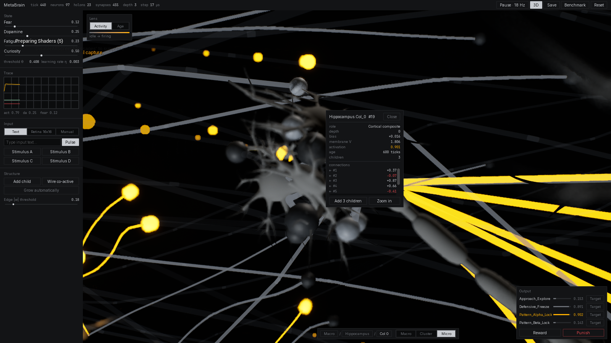
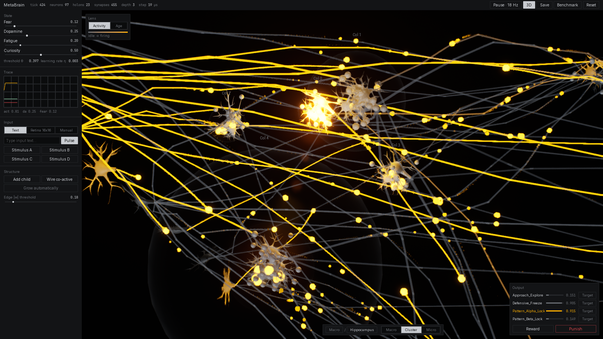

# MetaBrain: Neuron Realism Report (2026-11-18)




## 1. How the whole system works

```
C++20 sim engine (src/, include/metabrain)          <- Neuron holons, Hebbian learning, neuromodulators
   │  FMetaBrainSimBridge (Source/MetaBrainCore)       runs the engine on a worker thread (~18 Hz)
   ▼  immutable FMetaBrainSnapshot (neurons, edges, holons, tick)
AMetaBrainSceneController (Source/MetaBrainViz)      <- turns each snapshot into GPU instances
   ├─ NeuronMorphHISM   SM_NeuronSoma per neuron (Nanite)       NEW
   ├─ HeroNeuronISM     SM_NeuronFull for the selected neuron   NEW
   ├─ NeuronHISM        hidden sphere proxy, used only for cursor hit-tests
   ├─ EdgeFilamentHISM  curved Bezier axon tracts (graph edges)
   ├─ SynapticBoutonHISM boutons where axons dock on dendrite tips
   ├─ SignalPulseHISM   comet-tail spike pulses
   └─ HolonShellHISM, labels, firing point lights, post-process
UMG HUD + Slate oscilloscope (MetaBrainHUDWidget)    <- controls, inspector, trace
```

Per-instance custom data `[Activation, Maturity, Isolation, Flash]` drives `M_Neuron`:
gray at rest → amber emissive while firing; the Age lens switches it via `MPC_MetaBrain`.

### Asset pipeline (everything is rebuilt from scripts, no manual editor work)
1. `python Scripts/build_assets/prepare_neuron_mesh.py <neuron.glb>` (plain Python + numpy; only rerun if the source model changes)
   - finds the soma with a sphere-fit vote (each vertex votes for `position − normal·r`)
   - aligns the axon to +Z and scales the soma radius to 50 units (the same convention as the old sphere)
   - writes `meshes/SM_NeuronSoma.glb` (soma + dendrites + axon initial segment, 11.5k tris)
   - writes `meshes/SM_NeuronFull.glb` (membrane / myelin / Schwann nuclei, 39k verts, 3 material slots)
   - writes `Source/MetaBrainViz/Private/MetaBrainNeuronMorphologyData.h` (hillock tip + 11 real dendrite tips)
2. Run the `build_all.py` commandlet (see MANUAL_STEPS.md). It builds the materials (`M_Neuron` now Nanite + organic noise, new `M_Myelin` and `M_SchwannNucleus`), imports both meshes with Nanite, and checks the bounds (error 0.00 cm).
3. Build the C++ and launch. If the mesh assets are missing, the code falls back to the old sphere + cylinder arbor.

## 2. What we have now
- A real sculpted neuron for every cell (soma, branching dendrites, axon hillock). Each instance gets a different roll so the cells don't look identical.
- Synapse edges dock onto the mesh's real dendrite tips and leave from the real axon hillock.
- Selecting a neuron swaps in the full cell: a myelinated axon with 7 sheath segments, Schwann nuclei and axon terminals.
- Subsurface tissue shading, world-space mottling, a lipid-like myelin material, and firing glow and bloom on the real geometry.
- Nanite keeps the cost flat. The 10k-neuron profile still needs re-measuring (see below).

## 3. What we don't have (honest gap list toward "100% realism")
| Gap | Why it matters | Fix / effort |
|---|---|---|
| **One morphology for all cells** | Real tissue mixes pyramidal, stellate, Purkinje and interneuron shapes | Import 3–5 NeuroMorpho.org SWC reconstructions as variants. About 1 day |
| **Source model is textbook-stylised and nearly flat** (about ±0.5 soma radii thick) | Seen edge-on it looks thin; real arbors are fully 3D | Same fix as above (real SWC data) |
| **No textures or normal maps** (the source GLB has none) | Lacks membrane micro-detail, spines and roughness variation | Bake a tileable membrane normal map plus a spine displacement. Half a day |
| **No dendritic spines or real boutons on the mesh** | They are visible at close zoom in real micrographs | Spine instances scattered on dendrite vertices. Half a day |
| **The axon is a stylised curve, not the mesh**, except for the selected neuron | Myelin and nodes of Ranvier only appear on the hero cell | Spline-mesh myelin segments along edges. About 1 day |
| **No glia, vasculature or extracellular space** | Real tissue is about 50% glia; the scene reads as cells floating in a void | Astrocyte/capillary instanced set plus volumetric fog. 1–2 days |
| **Colour is stylised** (gray/amber signal palette) | Real tissue looks different under each imaging method (EM, fluorescence, Golgi stain) | Add a "Microscopy" lens that swaps the MPC palette. 2 h |
| Web frontend (`frontend/`, three.js) still draws spheres | The browser view doesn't match UE | GLTFLoader + InstancedMesh of SM_NeuronSoma.glb. 2–3 h |

## 4. Performance (2560×1440, no vsync, same rig and flags as the MANUAL_STEPS baseline)
| Tier | Neurons / synapses | Spheres (before) | Real mesh (now) | P95 frame | GT / RT / GPU ms |
|---|---|---|---|---|---|
| 1k | 1,028 / 11,132 | 257 fps | 99 fps avg | 7.6 ms (≈130 fps) | 3.3 / 6.7 / 4.7 |
| 10k | 10,194 / 80,472 | 75.8 fps | **71.1 fps** | 12.4 ms | 4.3 / 10.3 / 6.6 |

- 10k stays far above its 30 fps target and lost only about 6%.
- The 1k average is pulled down by a few spike frames (P95 is better than the average). The likely cause is the first-use Nanite/shader cost and the topology rebuild.
- RenderThread is the bottleneck at both tiers. NeuronHISM (the hidden proxy) and NeuronMorphHISM both receive custom data, so the proxy upload could be dropped. That is the obvious next optimisation.

## 5. Files touched
- New: `Scripts/build_assets/prepare_neuron_mesh.py`, `build_meshes.py`, `meshes/*.glb`, `MetaBrainNeuronMorphologyData.h`
- Changed: `build_materials.py`, `build_all.py`, `MetaBrainSceneController.{h,cpp}`, `README.md` (CC-BY credit, required by the model's license)

## 6. Update: Net / Brain views (later the same day)
Sections 2–3 describe the first pass. Since then, the app has two view modes (HUD **Net** / **Brain**, or `-View=Net|Brain`):

**Brain view now has**
- A translucent human brain from BodyParts3D. The outline hides automatically once the camera goes inside, and the HUD **Outline** button turns it off.
- 4 real human cell types from NeuroMorpho.org: L5 pyramidal, CA1 pyramidal, interneuron and Purkinje. Each cell gets ±25% width/depth variation.
- Anatomical placement:
  - Prefrontal, parietal and cerebellar neurons lie **on the folded cortical surface**, as a layer about 7 cm deep at scene scale.
  - Hippocampus, amygdala and thalamus are compact nuclei.
- Hair-thin myelinated axons that bundle into white-matter tracts between structures, with glial nuclei around each cell.
- Action potentials are soft light streaks.
- A warm subsurface membrane with a cool rim.
- Cinematic post-processing: depth of field that follows the orbit pivot, wide bloom, a teal/warm grade, vignette and grain.

**Net view now has** thin connections whose width scales with |w|: cyan for excitatory, magenta for inhibitory. They fade with depth, and nodes have a glowing halo.

**Controls**
- Left-drag orbits the brain.
- Right-drag, middle-drag or Shift + left-drag pans like a canvas: the point under the cursor stays under it.
- The wheel zooms toward the cursor.

**Still missing**
| Gap | Effort |
|---|---|
| More than one reconstruction per cell type. Variation is procedural only. | 2 h (more SWC downloads) |
| Connection budget capped at 3,200 drawn. Raising it needs GPU-instanced spline curves. | about 1 day |
| Impulse spark particles (Niagara). Impulses are mesh streaks today. | about 1 h |
| Web frontend (three.js) still draws spheres | about 1 day |
